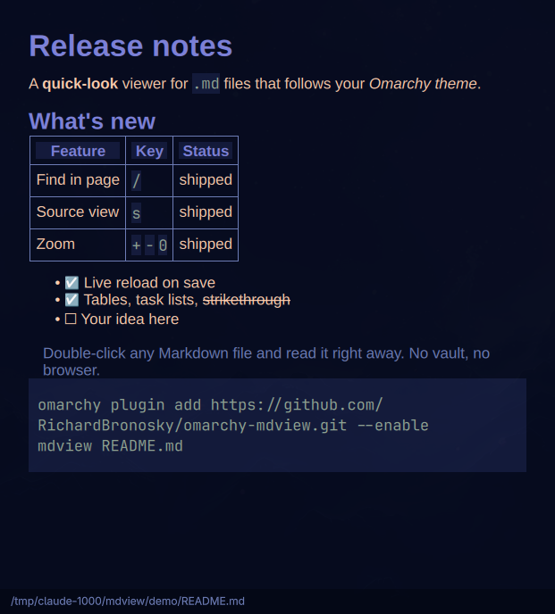

# mdview: Markdown viewer plugin for Omarchy



A quick-look Markdown viewer for [Omarchy](https://omarchy.org). Double-click a
`.md` file (or run `mdview README.md`) and it opens right away in a window that
matches your Omarchy theme, like the PDF viewer does for PDFs.

- **No extra packages.** It renders with `md2html` (md4c) and runs inside
  `omarchy-shell` (Quickshell), both already on every Omarchy install. No
  pandoc, WebKit, Electron or Obsidian vault needed.
- **GitHub-flavored Markdown:** tables, task lists, strikethrough, autolinks,
  code blocks. Relative images load from the file's folder.
- **Live reload:** it refreshes when the file is saved and when you switch themes.
- **Keyboard-driven:** vim-style scrolling, find, source view, zoom.

## Dependencies

Everything mdview needs ships with Omarchy, so there's nothing to install:

- `omarchy-shell` / Quickshell (runs the viewer)
- `md2html` from `md4c` (renders the Markdown)
- `jq` and `python3` (used by the `mdview` launcher)
- `xdg-utils` (Open With entry and the optional default-app switch)

## Install

```bash
omarchy plugin add https://github.com/RichardBronosky/omarchy-mdview.git --enable
~/.config/omarchy/plugins/io.github.richardbronosky.mdview/install.sh
```

`install.sh` adds the `mdview` command (a symlink in `~/.local/bin`) and a
**Markdown Viewer** entry under "Open With" in the file manager
(`~/.local/share/applications/mdview.desktop`). It leaves your current default
`.md` app alone. To make mdview the default for `.md` files:

```bash
~/.config/omarchy/plugins/io.github.richardbronosky.mdview/install.sh --default
```

## Use

```bash
mdview notes.md                 # one window per file
mdview *.md
omarchy-shell shell summon io.github.richardbronosky.mdview '{"file":"/abs/path/notes.md"}'
```

| Keys | Action |
|---|---|
| `j` / `k`, arrows | scroll |
| `space` / `b`, PgDn / PgUp, `Ctrl+D` / `Ctrl+U` | page down / up |
| `g` / `G`, Home / End | top / bottom |
| `/` or `Ctrl+F`, then `n` / `N` | find next / previous |
| `s` | toggle Markdown source |
| `+` / `-` / `0` (with or without Ctrl) | zoom in / out / reset |
| `r` | reload |
| `e` | open the file's folder |
| `Ctrl+C` | copy selection |
| `q` / `Esc` | close |

Links open in your default browser.

## How it works

- `Viewer.qml` is a `panel` plugin. Each summon opens a `ViewerWindow`. When the
  last window closes the panel unloads, so it uses no memory while idle.
- `ViewerWindow.qml` runs `md2html --github`, styles the HTML with colors from
  `~/.local/state/omarchy/current/theme/colors.toml`, and shows it as Qt rich text.
- `bin/mdview` summons the plugin over shell IPC. If the plugin isn't enabled, it
  opens a standalone Quickshell window (`Standalone.qml`) instead.

Qt rich text covers what notes and READMEs need. It isn't a browser engine, so
raw HTML embeds, Mermaid and math aren't rendered.

## Update / remove

```bash
omarchy plugin update io.github.richardbronosky.mdview
omarchy restart shell           # the shell keeps running the old plugin code until restarted
~/.config/omarchy/plugins/io.github.richardbronosky.mdview/install.sh --remove
omarchy plugin remove io.github.richardbronosky.mdview
```

## License

MIT
